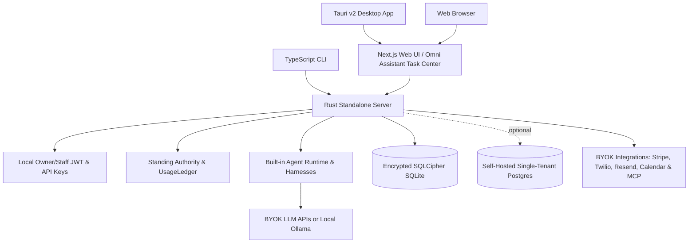

# OneHumanCorp (Community Edition)

**OneHumanCorp** by **OmniSolo** is an open-source (`Apache-2.0`), single-tenant AI business operations platform for solo business owners. Run your proposals, quotes, invoicing, bookings, storefront, CRM, unified inbox, and delegated AI workflows on your own machine or personal VPS — with encrypted SQLCipher SQLite storage by default and zero external infrastructure required.

- **License:** [Apache License, Version 2.0](LICENSE)
- **Editions:** [Community vs. OneHumanCorp Cloud](docs/public/edition-comparison.md)
- **Documentation:** [User Guide](docs/user_guide.md) · [Native Development Guide](docs/development/native-build.md) · [Release Notes](docs/public/release_notes.md)

---

## Key Capabilities

- **Omni Assistant Task Center & Vibe Spaces:** Conversational operations workspace for delegating, reviewing, and tracking business tasks alongside structured approval cards and live execution progress.
- **Server-Enforced Standing Authority & Hard Budgets:** Owners define explicit standing authority rules and hard micro-USD spending caps enforced server-side through the local `UsageLedger` and `ConnectionVault` — never by prompts alone.
- **Full Solo-Owner Business Operations:** Proposals, interactive quotes, invoicing, client booking & calendar scheduling, customer product subscriptions, catalog, orders, POS/terminal, fulfillment, shipping, storefront/website builder, CRM, unified customer inbox, customer memory graph, and owner-controlled growth widgets.
- **Merchant Payments (BYOK Stripe):** Connect your own Stripe account via `ConnectionVault` to accept proposal deposits, invoice payments, bookings, storefront checkouts, and customer subscriptions directly.
- **BYOK & Local AI Agents:** Use your own API keys (OpenAI, Anthropic, MiniMax, Gemini, or any OpenAI-compatible endpoint) or run fully local open-weights models via **Ollama**.
- **Multi-Harness Agent Execution & MCP:** First-party built-in agent runtime plus session/task middleware for Codex app-server v2, OpenCode, DeepSeek Harness, Pi, Kimi ACP, OpenHands Agent Server, and AgentBoardTT OpenHarness, along with inbound/outbound Model Context Protocol (MCP) tooling and a Block-based Visual Workflow engine (`/api/v1/workflow/run`). See the [harness compatibility inventory](docs/omnisolo-harness-compatibility-inventory.md).

---

## Quick Start

### Option 1: Standalone Docker Compose (Recommended for Self-Hosting)

The standalone Compose stack runs the single-tenant Rust API (`server`) with encrypted SQLCipher SQLite and the Next.js web UI (`web`). Optional profiles add self-hosted single-tenant PostgreSQL (`--profile postgres`) or local Ollama inference (`--profile ollama`).

1. Generate private local secrets and environment settings (`.omnisolo-compose/compose.env`):
   ```bash
   ./deploy/scripts/prepare-compose-env.sh
   ```

2. Build and start the standalone stack:
   ```bash
   docker compose --env-file .omnisolo-compose/compose.env \
     -f deploy/docker-compose.yml up -d --build
   ```

3. Optional profiles:
   ```bash
   # Include optional local Ollama LLM inference:
   docker compose --env-file .omnisolo-compose/compose.env \
     -f deploy/docker-compose.yml --profile ollama up -d --build

   # Include optional self-hosted single-tenant PostgreSQL:
   docker compose --env-file .omnisolo-compose/compose.env \
     -f deploy/docker-compose.yml --profile postgres up -d --build
   ```

Services in `deploy/docker-compose.yml`:

| Service | Default Port (loopback) | Profile | Description |
| --- | --- | --- | --- |
| `web` | `127.0.0.1:3000` | default | Next.js web application (Omni Assistant Task Center & business UI) |
| `server` | `127.0.0.1:8080` | default | Rust standalone API server & built-in agent runtime (SQLCipher SQLite in `/data`) |
| `postgres` | `127.0.0.1:5432` | `postgres` | Optional self-hosted single-tenant PostgreSQL (`pgvector`) |
| `ollama` | `127.0.0.1:11434` | `ollama` | Optional local open-weights LLM runtime |

For API-only deployments without the web UI, set `OMNISOLO_HEADLESS=true` on `server`.

---

### Option 2: Native Desktop & Local Development

Prerequisites: Git, GNU Make, Python 3.11+, the pinned Rust toolchain (`rust-toolchain.toml`), and the pinned Node.js version (`.node-version`). See [Native Development Setup](docs/development/native-build.md) for platform packages and Tauri desktop prerequisites.

```bash
make init
make doctor
```

Launch standalone backend + Tauri desktop app together:

```bash
./deploy/scripts/omnisolo-standalone.sh
```

Or run the backend, web UI, and desktop client in separate terminals:

```bash
# Terminal 1: configure standalone shell defaults and start the Rust backend
source deploy/scripts/omnisolo-mode.sh standalone
./deploy/scripts/omnisolo-quick-start.sh

# Terminal 2: start the Next.js web application
npm run dev:web

# Optional Terminal 3: launch the Tauri desktop shell
npm run desktop:dev
```

Interactive local helpers in `deploy/scripts/`:
- **Environment Wizard:** `./deploy/scripts/omnisolo-env-wizard.sh` (creates/updates `.env` with `0600` permissions)
- **Developer Setup:** `./deploy/scripts/omnisolo-setup.sh` (initializes standalone `.env` and verifies local backend checks)
- **Mode Switching:** `source deploy/scripts/omnisolo-mode.sh [standalone|headless]`
- **Diagnostics:** `./deploy/scripts/omnisolo-diagnostics.sh`
- **Verification:** `./deploy/scripts/omnisolo-verify-setup.sh`

---

## Architecture

OneHumanCorp Community runs as a self-contained single-tenant stack with local encrypted persistence by default:



### Source Layout

| Directory | Language | Purpose |
| --- | --- | --- |
| `src/server/` | **Rust** | Standalone Axum/tonic API server, local auth, business domain services, `ConnectionVault`, `UsageLedger`, and agent harness |
| `src/agents/` | **Rust** | Built-in agent runtime (`omnisolo_builtin_agent`: core, LLM adapters, tools) |
| `src/ui/next/` | **React / TypeScript** | Next.js web application and Omni Assistant Task Center |
| `src/ui/tauri/` | **Rust / TypeScript** | Native Tauri v2 desktop/mobile shell packaging a fresh standalone Next.js server |
| `src/cli/` | **TypeScript** | Standalone terminal CLI |
| `src/proto/` | **Protobuf** | Shared gRPC and data contracts |
| `src/e2e/` | **TypeScript** | Real-stack Playwright end-to-end tests |
| `deploy/` | **YAML / Shell** | Standalone Docker Compose, container Dockerfiles, local harness configs, and setup scripts |
| `docs/` | **Markdown** | User guide, edition comparison, API docs, and developer documentation |

---

## Build, Lint & Test

The build uses **Cargo** for Rust, **npm** for Next.js/CLI, and the **Tauri CLI** for desktop packaging:

```bash
# Full lint gate (Rust fmt/Clippy, ESLint, TypeScript)
make lint

# Full test suite (Rust workspace, Node/web/CLI/desktop UI, contracts, real-stack E2E)
make test
```

Focused iteration lanes:

```bash
# Headless Rust workspace checks
cargo fmt --all -- --check
cargo clippy --locked --workspace --exclude app --all-targets -- -D warnings
cargo test --locked --workspace --exclude app

# Focused harness crate tests
cargo test --locked -p server_harness

# Web, CLI, and desktop UI checks
npm run lint:node
npm run typecheck:web
npm run test:web
npm run build:web
npm --prefix src/cli run typecheck
npm --prefix src/cli test
npm run test:desktop-ui

# Build release binaries and desktop app
npm run build:server
npm run build:worker
npm run desktop:build -- --debug --no-bundle
```

### Real-Stack Playwright E2E

Playwright tests run against freshly built Rust binaries, the freshly built Next.js server, and real persisted database state (zero mocked API routes):

```bash
make build-e2e
npx --no-install playwright install chromium
npm run test:e2e
```

---

## Configuration

| Variable | Description |
| --- | --- |
| `OMNISOLO_STANDALONE_MODE` | Set `true` to run in single-tenant standalone mode (default in `deploy/docker-compose.yml`) |
| `OMNISOLO_SQLITE_KEY` | Encryption key for local SQLCipher SQLite storage (required in standalone SQLite mode) |
| `DATABASE_URL` | Defaults to encrypted SQLCipher SQLite (`sqlite:///data/omnisolo-standalone.db?mode=rwc`); set a `postgres://...` DSN when using self-hosted single-tenant PostgreSQL |
| `OMNISOLO_PORT` | HTTP API listen port (`18789` default natively; `8080` inside Docker Compose) |
| `OMNISOLO_GRPC_PORT` | Internal gRPC listen port (defaults to `8081`) |
| `OMNISOLO_HEADLESS` | Set `true` for API-only deployments without serving UI routes |
| `JWT_SECRET` / `JWT_SECRET_FILE` | Signing secret (or secret file path) for local owner/staff JWT authentication |
| `OMNISOLO_SETUP_TOKEN_FILE` | One-time setup token file for initial admin account creation |
| `OMNISOLO_WEB_CANONICAL_ORIGIN` | Public origin URL of the Next.js web server (e.g., `http://127.0.0.1:3000` locally or `https://...` in production) |
| `OMNISOLO_WEB_SESSION_SECRET` | Secret key protecting browser session cookies in the Next.js web server |
| `OMNISOLO_LLM_PROVIDER` | Built-in agent provider: `openai`, `anthropic`, `minimax`, `ollama`, or `openai-compatible` |
| `OMNISOLO_LLM_MODEL` | Default model identifier for the configured provider |
| `OMNISOLO_LLM_API_KEY` | API key for `openai-compatible` providers (or fallback key for OpenAI/MiniMax) |
| `OMNISOLO_LLM_BASE_URL` | Custom OpenAI-compatible API root URL (e.g., `https://api.example.com/v1`) |
| `OMNISOLO_LOCAL_LLM_ENDPOINT` | Local inference URL (e.g., `http://127.0.0.1:11434` or `http://ollama:11434` for Ollama) |
| `OPENAI_API_KEY` | OpenAI BYOK API key |
| `ANTHROPIC_API_KEY` | Anthropic BYOK API key |
| `MINIMAX_API_KEY` | MiniMax BYOK API key |
| `GEMINI_API_KEY` | Gemini BYOK API key |
| `OMNISOLO_CONNECTION_KEYS` / `OMNISOLO_CONNECTION_ACTIVE_KEY` | Runtime keyring and active key ID for encrypted `ConnectionVault` provider credentials |
| `MCP_BUNDLE_DIR` | Directory containing local MCP server bundles |

Keep secrets outside source control (use `scripts/env-vault.sh` or `.omnisolo-compose/compose.env` with `0600` permissions).

---

## Community vs. OneHumanCorp Cloud

OneHumanCorp Community (`Apache-2.0`) gives solo business owners the complete single-tenant product with no feature paywalls. If you want managed multi-tenant hosting, high-availability clusters, enterprise SSO/OIDC, real-time multi-device cloud sync, or commercial SLA support, see the [Edition Comparison](docs/public/edition-comparison.md).

## License

Copyright 2026 OmniSolo LLC (OneHumanCorp). Licensed under the [Apache License, Version 2.0](LICENSE).
