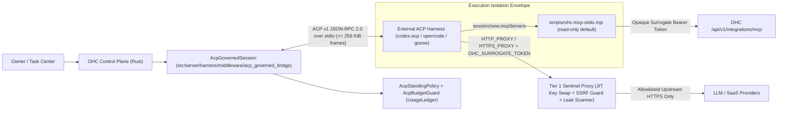
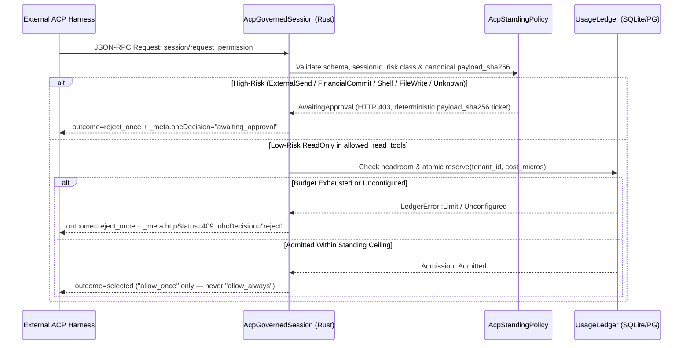

# ACP Governed Execution Layer Architecture

## Purpose & Design Principle

OneHumanCorp (OHC) does **not** re-implement bespoke coding/agent loops for every upstream agent harness. Instead, OHC treats external agent runtimes — such as `codex` (via an ACP adapter), `opencode`, `goose`, or any custom **Agent Client Protocol (ACP v1)** binary — as replaceable execution engines wrapped inside OHC's **protocol-governed control plane**.

OHC's differentiating moat lives outside the agent loop:

1. **Zero-secret child execution** via Tier 1 Sentinel surrogate credentials and egress proxies.
2. **Server-enforced standing authority** intercepting every bidirectional ACP `session/request_permission` request in Rust.
3. **Atomic micro-USD budget enforcement** backed by OHC's durable `UsageLedger` (strictly separating `ManagedApi` spend from non-rebilled `ByokApi`, `Local`, and `NativeSubscription` usage).
4. **Tenant-scoped business tools via MCP** injected automatically into ACP `session/new.mcpServers` using `scripts/ohc-mcp-stdio.mjs`.
5. **Defense-in-depth Tier 1 / Tier 2 / Tier 3 sandboxing** matching local standalone and cloud multi-tenant threat models.

---

## System Topology

---

## Core Components

### 1. Declarative Registry & Config-as-Code (`registry.rs`)

- **`AcpExternalHarnessSpec`**: Declares `harness_id`, `executable`, `args`, `protocol_version` (validated against `ACP_PROTOCOL_VERSION = 1`), `supported_sandbox_tiers`, and optional `mcp_bridge_command`.
- **`AcpHarnessRegistry`**: Loads standard local binary descriptors (`codex`, `opencode`, `goose`) or JSON config-as-code definitions. **Zero vendor API endpoints or credentials are hardcoded**; every runtime proxy URL and OHC MCP base URL must be supplied explicitly and validated fail-closed.
- **`build_sanitized_env` + `process_env::apply_isolated_environment`**:
  - Invokes `Command::env_clear()` so ambient host secrets (`OPENAI_API_KEY`, `STRIPE_SECRET_KEY`, `ANTHROPIC_API_KEY`, cloud IAM keys, database URLs) never cross into the child harness.
  - Scopes `HOME`, `TMPDIR`, `TMP`, `TEMP`, and `XDG_*` to private `0700` directories inside the session workspace (preventing accidental reads of host `~/.config` credentials).
  - Injects **only** the opaque Tier 1 surrogate token (`OHC_SURROGATE_TOKEN`, validated to reject raw vendor key prefixes like `sk-`, `sk_live_`, `ghp_`, `Bearer `) and Sentinel proxy URL (`OHC_SENTINEL_PROXY_URL`, `HTTP_PROXY`, `HTTPS_PROXY`).

### 2. Bounded ACP v1 Session Transport (`session.rs`)

- Spawns the configured external harness with `kill_on_drop(true)` and workspace-bound `current_dir`.
- Reads and writes newline-delimited JSON-RPC 2.0 over stdio with a strict **`256 KiB` (`MAX_ACP_FRAME_BYTES`)** frame ceiling. Oversized or malformed frames immediately terminate and reap the child process.
- Reuses `AcpV1Codec` (`src/server/harness/middleware/acp.rs`) for protocol handshake validation, `session/update` decoding, credential redaction, `session/prompt` completion, and `session/cancel` emission.
- Injects tenant-scoped `mcpServers` entries into `session/new` so the external harness automatically discovers OHC's business tools through `scripts/ohc-mcp-stdio.mjs` using the opaque surrogate token (`OHC_MCP_ALLOW_WRITE=false` by default).
- Cancellation (`AcpCancelHandle::cancel`) emits ACP `session/cancel` and waits up to `cancel_grace_period` for `stopReason: "cancelled"`. If an unresponsive child ignores cancellation, OHC forcefully kills and reaps it (`child.kill().await` + `child.wait().await`) so zero zombie processes leak.

### 3. Server-Enforced Governance on `session/request_permission` (`policy.rs`)

Key security invariants enforced in Rust (never delegated to prompts or the external harness):

- **High-risk actions are classified before allowlist matching**: `send_email`, `financial_commit`, shell `execute`, and file `edit`/`delete`/`move` can never masquerade as read-only tools.
- **No blanket client-side caching**: OHC only ever selects `allow_once` (never `allow_always`), ensuring every subsequent privileged action passes back through Rust governance.
- **Deterministic approval tickets**: Escalated requests compute a canonical recursive-key-sorted SHA-256 `payload_sha256` over `(tenant_id, department, session_id, tool_call_id, tool_name, acp_kind, estimated_cost_micros, raw_input)`.
- **Disabled client-side host tools**: `initialize` advertises `fs: false` and `terminal: false`; any unexpected server-to-client request (such as `fs/write_text_file` or `terminal/create`) is immediately rejected with JSON-RPC `-32601`.
- **Billing separation**: `ManagedApi` actions atomically reserve micro-USD in `UsageLedger`; `ByokApi` and `Local` actions record visibility without rebilling customer-direct inference.

---

## Integration with OHC's 3-Tier Sandbox Model

| Sandbox Tier | Isolation Boundary | How ACP Governed Bridge Runs Inside It |
| --- | --- | --- |
| **Tier 1 (Sentinel & WASM)** | Opaque surrogate credential broker, SSRF-hardened egress proxy, response secret leak scanner, WASM tool budget ceilings. | Supplies `OHC_SURROGATE_TOKEN` + `OHC_SENTINEL_PROXY_URL` to `AcpSessionLaunchConfig` and `scripts/ohc-mcp-stdio.mjs`. External harnesses never hold raw tenant API keys. |
| **Tier 2 (Local OS Sandbox)** | Linux `bwrap` (`--ro-bind`, `--unshare-net`, `--unshare-pid`, `--die-with-parent`) or macOS Seatbelt default-deny profiles. | Permitted for local single-tenant desktop/CLI workflows (`codex`, `opencode`, `goose`) with workspace-scoped `HOME`/`TMPDIR` and Sentinel-only network egress. |
| **Tier 3 (Cloud MicroVM)** | Dedicated Firecracker microVM or Kubernetes Kata Containers / gVisor (`runsc`) pods with tenant `NetworkPolicy` blocking RFC1918 & `169.254.169.254`. | **Mandatory** for cloud multi-tenant execution. `AcpHarnessRegistry::resolve_for_tier` enforces tier compatibility before spawning any external ACP binary. |
